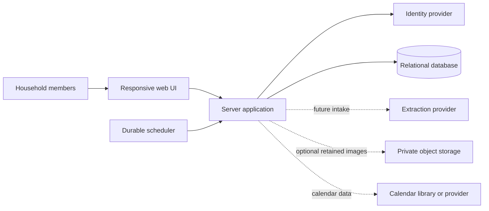

# Family Meal Planner — Architecture and Readiness Audit

**Status:** Proposed architecture for discussion; no implementation or provider choices approved  
**Date:** November 22, 2026  
**Source:** [Product requirements](PRD.md), draft of November 22, 2026  
**Scope:** Initial private household and the manual recipe → plan → shopping-list slice, with extension points for the rest of the first release.

## 1. Readiness verdict

**Ready to begin architecture design and focused technical discovery. Not yet ready for an unrestricted implementation or production launch.** The PRD identifies the users, primary journey, scope boundaries, useful acceptance examples, and meaningful privacy and reliability constraints. It also names a plausible deployment shape. There is no application code or existing architecture in this repository to constrain the design.

The manual vertical slice can be specified first, but its implementation should follow decisions on identity and access, plan/history boundaries, and list reconciliation. Scheduled suggestions, calendar display, and AI intake each need additional decisions or feasibility work before their respective implementation. These gates need not all be resolved before architecture work begins.

### PRD audit

| Area | Assessment | Evidence and remaining work |
| --- | --- | --- |
| Users and outcome | Strong for a household trial | Two household members, private planning, and a four-week qualitative validation are defined. Numeric targets are intentionally deferred until a baseline exists. |
| First journey and scope | Mostly clear | Manual recipes, four dinner slots, finalization, and a traceable list form a coherent slice. The milestones place finalization after the vertical slice, although the list is defined as generated on finalization; resolve sequencing below. |
| Recipe and plan lifecycle | Needs a decision | Edits update active plans while past weeks remain historical, but the cutoff and behavior when an old week is reopened are unspecified. |
| Shopping list | Needs a detailed contract | Good arithmetic examples and preservation requirements exist; item identity, conflicts, and review resolution across recalculation are not specified. |
| Identity and privacy | Architecture direction clear; launch policy open | Two authorized identities and server enforcement are required. Provisioning, recovery, session behavior, and provider remain open. |
| Suggestions and scheduling | Needs product and operational decisions | Time zone, idempotency, locks, and no-overwrite behavior are stated; rating policy, retries, missed schedules, and partially edited drafts need precise rules. |
| Calendar | Needs configuration decisions | Israel/diaspora, observance set, location-based times and conventions are unsettled; failures must remain visible. |
| Intake and external services | Discovery required | Supported sources, integration feasibility, provider, retention, and costs remain open. Manual entry is viable independently. |
| Operations and quality | Direction established; targets open | Backup/restore, export/deletion, accessibility, and privacy are identified, but service levels, recovery targets, budget, and operational ownership are unchosen. |

**Milestone clarification proposed:** include explicit finalization and the resulting list in the manual vertical slice, because they are necessary to exercise the stated core journey. Defer automatic suggestions, scheduling, and AI intake to the next milestone. This is a sequencing recommendation, not a change to product scope.

## 2. Capability and boundaries

Two authorized household members maintain a private recipe library, assemble a Monday–Thursday dinner plan, finalize it, and obtain a correctable shopping list whose calculated quantities can be traced to meals. They can change the active plan and review the impact on their list. They can use free-form dinners and add missing shopping items manually.

**Fixed by the PRD:**

- Only authorized household members can use private features; enforcement occurs on the server for every operation. Household data is private by default.
- A week is identified by its local Monday. There is at most one weekly plan for the household; the Sunday run targets the upcoming week. A finalized plan or a household member's edits must never be overwritten by automatic generation.
- Recipes are stored as editable content, not just external links; archived recipes remain readable in referenced plans. Unknown ratings and quantities remain unknown.
- Active plans reflect recipe changes; historical weeks retain their records. The exact transition into history is a decision gate.
- Sum only confidently identical ingredients in compatible units. Preserve source lines and precision; do not infer volume-to-weight conversion or quantities. Keep ambiguous entries separate.
- Calculated shopping contributions and user changes are distinct. Recalculation preserves manual items and flags affected overrides, on-hand states, and check-offs for review.
- External content is untrusted. Extracted recipes are drafts until reviewed and saved; failure has a manual fallback.
- Calendar failure is visible and must not block ordinary planning. Calendar labels do not automatically suppress suggestions without a product decision.

**Out of scope for the first slice:** public publishing, detailed occasion planning, automatic scaling, multiple recipe dishes per dinner, pantry inventory, partial on-hand subtraction, delivery, nutrition, and automatic dietary or kosher enforcement. AI intake, automated suggestions, and calendar labels remain part of the broader first release or discovery as described in the PRD, but are not prerequisites for validating manual list arithmetic.

## 3. Proposed system shape

A responsive web application, one backend, and a relational database are appropriate for the small initial audience and transactional plan/list changes. Next.js with TypeScript and PostgreSQL is a **candidate**, as proposed in the PRD, not a settled decision. Compare it with the stated full-stack alternative and select hosting, database, authentication, and scheduling together before foundation implementation. Avoid separate services until operational or product needs justify them.

The server is the trust boundary: it verifies identity and household membership, validates commands, owns transactions, and returns household-scoped data. The browser never receives database credentials or authority to bypass these checks. Third-party services receive only data needed for their function. Public recipes, if later approved, must be served from an explicitly selected projection with its own access policy, rather than by making private household records broadly readable.

### Logical modules

- **Identity and household:** session verification, explicit account provisioning, authorization, and recovery.
- **Recipe library:** recipes, ingredients, ordered steps, ratings, sources, and archival; optional import drafts and private assets later.
- **Planning:** week and slot lifecycle, user edits, locks, finalization, snapshots, and suggestion orchestration.
- **Shopping:** normalized ingredient identities, unit rules, per-meal contributions, user-owned changes, and review state.
- **Calendar:** household settings and date labels behind a replaceable adapter; errors are distinct from an empty result.
- **Operations:** scheduled jobs, observability, backups, restore, export, and deletion.

These are logical boundaries in one deployable application, not a commitment to microservices. Framework routes and database schema are implementation details to select after the decision gates.

## 4. Data ownership and lifecycle

All private business records carry or derive a household ownership boundary. Proposed concepts, subject to schema design:

| Concept | Responsibility |
| --- | --- |
| User, household, membership | Stable provider identity mapped to an explicitly authorized household membership; session authentication is separate from authorization. |
| Recipe and revision | Editable title, ingredients, instructions, optional fields, original ingredient text, and source metadata. Immutable revisions or equivalent snapshots support historical plans. Archive excludes new suggestions without deleting referenced content. |
| Week plan, slot, planned item | Unique `(household, local Monday)`; four dinner slots initially. A slot holds a recipe reference or free-form note, plus lock and edit metadata. Plan is draft or finalized; changes after finalization remain possible. |
| Shopping list and contribution | One current finalized list per plan, with contributions keyed to a specific slot and ingredient line, including original values and normalized identity where known. User additions and overrides have separate ownership and lifecycle. |
| Calendar settings | Household time zone and Israel/diaspora schedule; optional location and timing conventions only if approved. |
| Import draft and asset | Future reviewable extraction result, status and source, with private optional asset and deletion policy. Drafts are not recipes until saved by an authorized user. |
| Job run | Household, target week, schedule, status, attempt and failure information sufficient for safe retry and visibility. |

### Plan and recipe transitions

1. A household member creates or edits recipes and enters or changes a draft plan. A draft may display a clearly labeled list preview.
2. Finalization records the current plan and produces its shopping list atomically. Finalization is explicit and does not lock future edits.
3. A later plan or active recipe edit recomputes affected contributions and marks affected user states for review in the same transaction. Manual items survive.
4. A defined transition makes a week historical and preserves the recipe content and list state needed to read it later. **The transition time, late corrections, and whether historical edits create an audit revision are open decisions.** Do not silently interpret “active” as “current week” without confirmation.

**Proposed concurrency rule:** use a plan/list revision or equivalent optimistic concurrency check. A stale edit receives a conflict and can be refreshed or reconciled rather than silently overwriting another member's work. Finalization and subsequent recalculation should be transactional; retries must not create duplicate plans or lists.

## 5. Shopping calculation contract

1. Preserve each recipe ingredient's original text, quantity, unit, and meal provenance. Parse into a structured quantity only when known; missing and “to taste” values remain unresolved.
2. Match only a recognized normalized ingredient identity and a compatible unit family. An unknown identity or unit stays separate. Count units require an explicit matching rule; never conflate an ingredient with a related form such as onion and onion powder.
3. Convert within a documented conversion table, using exact fractions or fixed-precision decimal arithmetic. Preserve underlying values and round only for display. No automatic weight/volume conversion; an ingredient-specific conversion requires an explicitly trusted source and product approval.
4. Aggregate calculated contributions into displayed list items with source meals. Apply manual additions, exclusions, quantity overrides, category corrections, on-hand state, and shopping check state separately. On-hand and purchased are distinct states.
5. On change, recompute from source contributions. Compare prior and new group membership and quantities; retain manual entries and flag affected user states for review. The UI must show enough old/new context for the family to resolve a change without silently losing its edits.

**Decision required before building reconciliation:** define durable item identity when lines merge or split; what an override means after recalculation; whether affected checks/on-hand states are retained provisionally or cleared; and how the user resolves flags. This contract deliberately does not imply that preserving a flag is equivalent to preserving the user's intent.

## 6. Scheduled suggestions and calendar

**Suggested architecture, not yet an approved algorithm:** a durable scheduler invokes server-side generation for the upcoming local-Monday week at Sunday noon in the household's configured time zone. Store a unique job key per household and target week, claim work safely, and record attempts and failures. A duplicate invocation is harmless. Plan creation and updates use concurrency protection; generation must not replace a finalized plan or edited/locked choices. A manual retry follows the same safety rules. Define how to fill remaining slots, rank rated versus unrated recipes, handle insufficient candidates, and report failure before implementing the generator. Define missed runs, retry window, time-zone changes and daylight-saving behavior with the scheduler choice.

Calendar calculations should take local dates, configured time zone, Israel/diaspora setting, and an explicit observance policy. Represent preceding evenings and overlapping or multi-day occasions as separate displayable labels. Treat unavailable data as an error state, not an empty calendar, and allow planning to continue. Evaluate a library or provider, its data coverage, attribution and operational behavior before selection. Location-based times and their conventions are explicitly undecided; do not fabricate defaults or times.

## 7. Security and operations

- Authenticate on the server and authorize household membership for every read and write, including asset access and job operations. Provision only the two approved stable identities; settle bootstrap, account loss, revocation, and shared-device sessions before launch.
- Validate all inputs. For future URL imports, restrict outbound fetching against private/internal networks, redirects, DNS rebinding, oversized responses and long-running requests; test the chosen implementation. Treat extracted content as untrusted. Keep assets private and authorize access.
- Make third-party processing and retention visible to users before enabling intake. Define retention/deletion for drafts, original photos, external-provider data, logs, and backups; avoid logging recipe content or sensitive account details.
- Back up database and retained assets, test restoration, and provide household export and deletion. Choose recovery objectives, retention, operator and costs before launch. Deletion and backup expiry need an explicit policy.
- Capture job failures, import outcomes, calendar failures, and operational errors without private content. Provide an actionable failure state and a manual path for the household.
- Design phone-first usable flows with keyboard access, labels, and readable contrast. Define concrete accessibility and availability targets during foundation planning.

## 8. Decision register and gates

| Priority / gate | Decision or investigation | Why it matters |
| --- | --- | --- |
| Before foundation implementation | Choose framework, hosting, database, auth provider, and deployment environment; agree budget and custom-domain needs. | Determines infrastructure, identity integration, and operational model. |
| Before private data or launch | Define the two account identifiers, secure bootstrap, recovery, revocation and shared-device behavior. | Prevents accidental lockout or unauthorized access. |
| Before plan/list implementation | Define when a week becomes historical, snapshot contents, late edits, and behavior when recipes are archived or changed. | Resolves active-update versus historical-record requirements. |
| Before list reconciliation | Specify merge/split identity, override semantics, on-hand/check behavior and review resolution, with examples. | Makes preservation and recalculation testable. |
| Before concurrent editing | Decide conflict UX and stale-edit recovery for both users. | Prevents silent loss of household edits. |
| Before suggestions | Decide collective versus individual ratings, balancing of conflicting or absent ratings, eligible recipes, edited-slot protection and regeneration behavior. | Enables a predictable algorithm without inventing preferences. |
| Before scheduled generation | Select scheduler; define retries, missed runs, time-zone changes, monitoring and recovery. | Establishes the Sunday guarantee and safe retry behavior. |
| Before calendar implementation | Confirm Israel/diaspora and observance set; decide whether location-based times are in MVP and, if so, conventions and source. | Determines data and display rules. Labels affect suggestions only if explicitly decided. |
| Before AI intake | Select initial sources and provider/integration after feasibility, cost, privacy, review, and revocation investigation. | Avoids assuming assistant access or processing capabilities. |
| Before launch | Set backup/restore and deletion policy, recovery and availability targets, accessibility expectations, and operational ownership. | Turns stated reliability and privacy goals into supportable commitments. |
| Before public publishing | Decide which recipes and fields can be published, source rights, and explicit publication workflow. | Prevents disclosure of household data and inappropriate republication. |

## 9. Delivery and verification

1. **Architecture and foundation:** resolve the first gates; record decisions and tradeoffs, configure local/deployment environments and migrations, and establish authorized access. No production launch is implied.
2. **Manual vertical slice:** recipe entry and archival; a local-week plan with manual slots and explicit finalization; list generation, traceability, manual additions and reconciliation; historical preservation under the agreed policy. Exercise the full flow on mobile and desktop.
3. **Broader first release:** calendar labels; ratings and scheduled suggestions with locks and safe retries; then selected intake sources with review and fallback. Sequence each only after its gates are resolved.
4. **Household trial:** use real recipes over four weeks and record planning time, quantity corrections, import edits, and friction against a baseline. Design occasion planning from actual family workflows afterward.

Verification should include the PRD's cup-plus-half-cup, volume-versus-weight, onion-versus-onion-powder, and plan-change examples; fractional precision; ambiguous quantities; source traceability; list merge/split and user-state review; recipe edit/archive and historical snapshots; authorization across household boundaries; concurrent edits; and transaction rollback. For the scheduled and calendar milestones, test duplicate runs, edited/finalized plans, insufficient candidates, local-time transitions, overlapping holidays, and provider failure. Test import security and review-before-save only when intake is built. Validate backup restoration before launch.

## 10. Handoff

**Next action:** review the decision register with the household and choose the initial deployment and identity constraints, history boundary, and list reconciliation examples. Then turn the accepted choices into implementation contracts and small, testable tasks for the manual vertical slice. Keep unresolved product choices visible rather than treating the proposals in this document as approved requirements.
