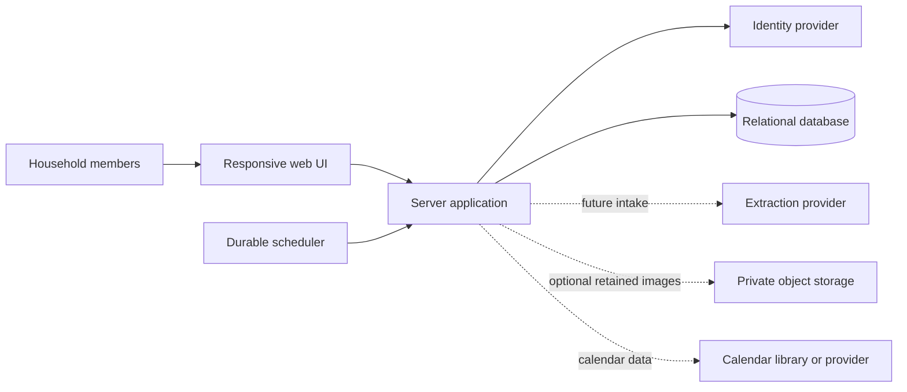

# Family Meal Planner — Architecture and Readiness Audit

**Status:** Architecture direction accepted in [ADRs 0001–0005](adr/README.md); implementation details and some providers remain unresolved
**Date:** November 22, 2026  
**Source:** [Product requirements](PRD.md), draft of November 22, 2026  
**Scope:** Initial private household and the manual recipe → plan → shopping-list slice, with extension points for the rest of the first release.

## 1. Readiness verdict

**Ready for focused proof-of-concept foundation work and contract design. Not yet ready for unrestricted implementation or production launch.** The PRD identifies the users, primary journey, scope boundaries, useful acceptance examples, and meaningful privacy and reliability constraints. It also names a plausible deployment shape. There is no application code or existing architecture in this repository to constrain the design.

The manual vertical slice can be specified first. Local accounts and server-side membership checks are accepted; the authentication solution and operational policies remain to be chosen. The history cutoff and read-only policy are confirmed below. Scheduled suggestions, calendar display, and AI intake each need additional decisions or feasibility work before their respective implementation. These gates need not all be resolved before architecture work begins.

### PRD audit

| Area | Assessment | Evidence and remaining work |
| --- | --- | --- |
| Users and outcome | Strong for a household trial | Two household members, private planning, and a four-week qualitative validation are defined. Numeric targets are intentionally deferred until a baseline exists. |
| First journey and scope | Mostly clear | Manual recipes, four dinner slots, finalization, and a traceable list form a coherent slice. Finalization is included in the manual vertical slice. |
| Recipe and plan lifecycle | Cutoff and read-only policy confirmed | Editable weeks follow recipe edits; each becomes historical at the following local Monday midnight and is read-only. Historical recipe content remains preserved under the existing policy; whether to simplify that policy and archive behavior remain open. |
| Shopping list | Needs a detailed contract | Good arithmetic examples and preservation requirements exist; the reconciliation contract below defines item identity and review; list scope and retention remain open. |
| Identity and privacy | Architecture direction clear; launch policy open | Two authorized identities and server enforcement are required. Local accounts are accepted for the proof of concept; the authentication solution, provisioning, recovery, and session behavior remain open. |
| Suggestions and scheduling | Needs product and operational decisions | Time zone, idempotency, locks, and no-overwrite behavior are stated; rating policy, retries, missed schedules, and partially edited drafts need precise rules. |
| Calendar | Needs configuration decisions | Israel/diaspora, observance set, location-based times and conventions are unsettled; failures must remain visible. |
| Intake and external services | Discovery required | Supported sources, integration feasibility, provider, retention, and costs remain open. Manual entry is viable independently. |
| Operations and quality | Direction established; targets open | Backup/restore, export/deletion, accessibility, and privacy are identified, but service levels, recovery targets, budget, and operational ownership are unchosen. |

**Milestone clarification:** explicit finalization and the resulting list are included in the manual vertical slice, because they are necessary to exercise the stated core journey. Defer automatic suggestions, scheduling, and AI intake to the next milestone.

## 2. Capability and boundaries

Two authorized household members maintain a private recipe library, assemble a Monday–Thursday dinner plan, finalize it, and obtain a correctable shopping list whose calculated quantities can be traced to meals. They can change the active plan and review the impact on their list. They can use free-form dinners and add missing shopping items manually.

**Fixed by the PRD:**

- Only authorized household members can use private features; enforcement occurs on the server for every operation. Household data is private by default.
- A week is identified by its local Monday. There is at most one weekly plan for the household; the Sunday run targets the upcoming week. A finalized plan or a household member's edits must never be overwritten by automatic generation.
- Recipes are stored as editable content, not just external links; archived recipes remain readable in referenced plans. Unknown ratings and quantities remain unknown.
- Editable weeks reflect recipe changes. At 12:00 a.m. on the following Monday in the household’s configured time zone, a week becomes historical and read-only; its plan and recipe content remain as of the cutoff under the existing policy. Historical shopping-list snapshots are not required for the MVP.
- Sum only confidently identical ingredients in compatible units. Preserve source lines and precision; do not infer volume-to-weight conversion or quantities. Keep ambiguous entries separate.
- Calculated shopping contributions and user changes are distinct. Recalculation preserves manual items and flags affected overrides, on-hand states, and check-offs for review.
- External content is untrusted. Extracted recipes are drafts until reviewed and saved; failure has a manual fallback.
- Calendar failure is visible and must not block ordinary planning. Calendar labels do not automatically suppress suggestions without a product decision.

**Out of scope for the first slice:** public publishing, detailed occasion planning, automatic scaling, multiple recipe dishes per dinner, pantry inventory, partial on-hand subtraction, delivery, nutrition, and automatic dietary or kosher enforcement. AI intake, automated suggestions, and calendar labels remain part of the broader first release or discovery as described in the PRD, but are not prerequisites for validating manual list arithmetic.

## 3. Proposed system shape

A responsive web application, one backend, and a relational database are appropriate for the small initial audience and transactional plan/list changes. The accepted direction is a modular Next.js application with React and TypeScript, PostgreSQL, and an initial home-network proof of concept on a Raspberry Pi ([ADR-0001](adr/0001-application-and-deployment.md), [ADR-0002](adr/0002-persistence-and-history.md)). Two local accounts are accepted for the proof of concept ([ADR-0003](adr/0003-identity-and-household-access.md)). The local authentication solution, HTTPS and deployment workflow, scheduler, and eventual cloud provider remain unresolved. Avoid separate services until operational or product needs justify them.

The server is the trust boundary: it verifies identity and household membership, validates commands, owns transactions, and returns household-scoped data. The browser never receives database credentials or authority to bypass these checks. Third-party services receive only data needed for their function. Public recipes, if later approved, must be served from an explicitly selected projection with its own access policy, rather than by making private household records broadly readable.

### Logical modules

- **Identity and household:** session verification, explicit account provisioning, authorization, and recovery.
- **Recipe library:** recipes, ingredients, ordered steps, ratings, sources, and archival; optional import drafts and private assets later.
- **Planning:** week and slot lifecycle, user edits, locks, finalization, historical meal-plan preservation, and suggestion orchestration.
- **Shopping:** normalized ingredient identities, unit rules, per-meal contributions, user-owned changes, and review state.
- **Calendar:** household settings and date labels behind a replaceable adapter; errors are distinct from an empty result.
- **Operations:** scheduled jobs, observability, backups, restore, export, and deletion.

These are logical boundaries in one deployable application, not a commitment to microservices. Framework routes and database schema remain implementation details to select after the relevant decision gates.

## 4. Data ownership and lifecycle

All private business records carry or derive a household ownership boundary. Proposed concepts, subject to schema design:

| Concept | Responsibility |
| --- | --- |
| User, household, membership | Stable provider identity mapped to an explicitly authorized household membership; session authentication is separate from authorization. |
| Recipe and revision | Editable title, ingredients, instructions, optional fields, original ingredient text, and source metadata. Immutable revisions or equivalent snapshots support historical plans. Archive excludes new suggestions without deleting referenced content. |
| Week plan, slot, planned item | Unique `(household, local Monday)`; four dinner slots initially. A slot holds a recipe reference or free-form note, plus lock and edit metadata. Plan is draft or finalized; changes after finalization remain possible. |
| Shopping list and contribution | The relevant current list has contributions keyed to a specific slot and ingredient line, including original values and normalized identity where known. User additions and overrides have separate ownership and lifecycle. Whether to maintain lists for multiple upcoming weeks and their retention remain open. |
| Calendar settings | Household time zone and Israel/diaspora schedule; optional location and timing conventions only if approved. |
| Import draft and asset | Future reviewable extraction result, status and source, with private optional asset and deletion policy. Drafts are not recipes until saved by an authorized user. |
| Job run | Household, target week, schedule, status, attempt and failure information sufficient for safe retry and visibility. |

### Plan and recipe transitions

1. A household member creates or edits recipes and enters or changes a draft plan. A draft may display a clearly labeled list preview.
2. Finalization records the current plan and produces its shopping list atomically. Finalization is explicit and does not lock future edits.
3. Adding, removing, replacing, or editing planned recipes recomputes affected contributions in the relevant list. Preserve manual items and safe checked/on-hand states; flag uncertain states for review. Changes and recalculation occur in the same transaction.
4. At 12:00 a.m. on the Monday following the planned week, in the household’s configured time zone, that week becomes historical and read-only. Preserve the plan and recipe content as of the cutoff under the existing policy; whether historical plans should instead show current recipe content remains open. Future weeks remain editable before their own cutoff. Historical shopping-list snapshots and complex historical reconciliation are not required for the MVP, and immutable list history solely for audit is unnecessary.

**Proposed concurrency rule:** use a plan/list revision or equivalent optimistic concurrency check. A stale edit receives a conflict and can be refreshed or reconciled rather than silently overwriting another member's work. Finalization and subsequent recalculation should be transactional; retries must not create duplicate plans or lists.

## 5. Shopping calculation contract

1. Preserve each recipe ingredient's original text, quantity, unit, and meal provenance. Parse into a structured quantity only when known; missing and “to taste” values remain unresolved.
2. Match only a recognized normalized ingredient identity and a compatible unit family. An unknown identity or unit stays separate. Count units require an explicit matching rule; never conflate an ingredient with a related form such as onion and onion powder.
3. Convert within a documented conversion table, using exact fractions or fixed-precision decimal arithmetic. Preserve underlying values and round only for display. No automatic weight/volume conversion; an ingredient-specific conversion requires an explicitly trusted source and product approval.
4. Aggregate calculated contributions into displayed list items with source meals. Apply manual additions, exclusions, quantity overrides, category corrections, on-hand state, and shopping check state separately. On-hand and purchased are distinct states.
5. On change, recompute from source contributions. Compare prior and new group membership and quantities; retain manual entries and flag affected user states for review. The UI must show enough old/new context for the family to resolve a change without silently losing its edits.

**Confirmed:** Preserve checked and on-hand states when safe. When a quantity or ingredient change makes a prior state uncertain, retain it for context and mark it as needing review. Do not present it as conclusively purchased or covered until a household member resolves the review.

**Detailed contract:** [ADR-0004](adr/0004-shopping-list-reconciliation.md) defines durable identity, merge and split behavior, overrides, review resolution, and examples. Retaining prior state for context does not preserve it as an active decision.

## 6. Scheduled suggestions and calendar

**Accepted scheduling behavior, with implementation and selection algorithm still open:** a scheduler invokes server-side generation for the upcoming local-Monday week at Sunday noon in the household's configured time zone. Store a unique job key per household and target week, claim work safely, and record attempts and failures. A duplicate invocation is harmless. Plan creation and updates use concurrency protection; generation must not replace a finalized plan or edited/locked choices. A manual retry follows the same safety rules. Define how to fill remaining slots, rank rated versus unrated recipes, handle insufficient candidates, and report failure before implementing the generator. Define missed runs, retry window, time-zone changes and daylight-saving behavior with the scheduler choice.

Calendar calculations should take local dates, configured time zone, Israel/diaspora setting, and an explicit observance policy. Represent preceding evenings and overlapping or multi-day occasions as separate displayable labels. Treat unavailable data as an error state, not an empty calendar, and allow planning to continue. Evaluate a library or provider, its data coverage, attribution and operational behavior before selection. Location-based times and their conventions are explicitly undecided; do not fabricate defaults or times.

## 7. Security and operations

- Authenticate on the server and authorize household membership for every read and write, including asset access and job operations. Provision only the two approved stable identities; settle bootstrap, account loss, revocation, and shared-device sessions before launch.
- Validate all inputs. For future URL imports, restrict outbound fetching against private/internal networks, redirects, DNS rebinding, oversized responses and long-running requests; test the chosen implementation. Treat extracted content as untrusted. Keep assets private and authorize access.
- Make third-party processing and retention visible to users before enabling intake. Define retention/deletion for drafts, original photos, external-provider data, logs, and backups; avoid logging recipe content or sensitive account details.
- Back up database and retained assets, test restoration, and provide household export and deletion. Choose recovery objectives, retention, operator and costs before launch. Deletion and backup expiry need an explicit policy.
- Capture job failures, import outcomes, calendar failures, and operational errors without private content. Provide an actionable failure state and a manual path for the household.
- Design phone-first usable flows with keyboard access, labels, and readable contrast. Define concrete accessibility and availability targets during foundation planning.

## 8. Decision register and gates

| Priority / gate | Decision or investigation | Why it matters |
| --- | --- | --- |
| Before foundation implementation | Choose the local authentication solution, Pi deployment and development workflow, local HTTPS and DNS. | Makes the accepted Pi, Next.js, PostgreSQL and local-account direction operable. Cloud provider, budget and domain remain later decisions. |
| Before private data or launch | Define the two account identifiers, secure bootstrap, recovery, revocation and shared-device behavior. | Prevents accidental lockout or unauthorized access. |
| Before plan/list implementation | Design cutoff enforcement and historical meal-plan/recipe preservation under the existing local-Monday, read-only policy; decide whether to simplify historical recipe content, and specify archive behavior. | Keeps past plans readable without requiring historical shopping-list snapshots. |
| Before list implementation | Decide whether users maintain lists for multiple upcoming weeks, list retention, and whether a fully editable list is available before finalization. | Defines selected-week behavior without assuming one storage model. The current design creates a list at finalization and permits a labeled draft preview. |
| Before list reconciliation | Implement and verify the identity, merge/split, override and review contract in [ADR-0004](adr/0004-shopping-list-reconciliation.md). | Makes current-list recalculation testable; uncertain on-hand/check states require review. |
| Before concurrent editing | Decide conflict UX and stale-edit recovery for both users. | Prevents silent loss of household edits. |
| Before suggestions | Decide collective versus individual ratings, balancing of conflicting or absent ratings, eligible recipes, edited-slot protection and regeneration behavior. | Enables a predictable algorithm without inventing preferences. |
| Before scheduled generation | Select scheduler; define retries, missed runs, time-zone changes, monitoring and recovery. | Establishes the Sunday guarantee and safe retry behavior. |
| Before calendar implementation | Confirm Israel/diaspora and observance set; decide whether location-based times are in MVP and, if so, conventions and source. | Determines data and display rules. Labels affect suggestions only if explicitly decided. |
| Before AI intake | Select initial sources and provider/integration after feasibility, cost, privacy, review, and revocation investigation. | Avoids assuming assistant access or processing capabilities. |
| Before launch | Set backup/restore and deletion policy, recovery and availability targets, accessibility expectations, and operational ownership. | Turns stated reliability and privacy goals into supportable commitments. |
| Before public publishing | Decide which recipes and fields can be published, source rights, and explicit publication workflow. | Prevents disclosure of household data and inappropriate republication. |

## 9. Delivery and verification

1. **Architecture and foundation:** resolve the first gates; record decisions and tradeoffs, configure local/deployment environments and migrations, and establish authorized access. No production launch is implied.
2. **Manual vertical slice:** recipe entry and archival; a local-week plan with manual slots and explicit finalization; list generation, traceability, manual additions and current-list reconciliation; read-only previous meal plans under the agreed policy. Historical shopping-list snapshots are not required. Exercise the full flow on mobile and desktop.
3. **Broader first release:** calendar labels; ratings and scheduled suggestions with locks and safe retries; then selected intake sources with review and fallback. Sequence each only after its gates are resolved.
4. **Household trial:** use real recipes over four weeks and record planning time, quantity corrections, import edits, and friction against a baseline. Design occasion planning from actual family workflows afterward.

Verification should include the PRD's cup-plus-half-cup, volume-versus-weight, onion-versus-onion-powder, and plan-change examples; fractional precision; ambiguous quantities; source traceability; current-list merge/split and user-state review; recipe edit/archive and read-only historical meal plans under the agreed recipe-content policy; authorization across household boundaries; concurrent edits; and transaction rollback. For the scheduled and calendar milestones, test duplicate runs, edited/finalized plans, insufficient candidates, local-time transitions, overlapping holidays, and provider failure. Test import security and review-before-save only when intake is built. Validate backup restoration before launch.

## 10. Handoff

**Next action:** resolve the remaining foundation and first-slice gates, and turn the accepted choices into small, testable tasks for the manual vertical slice. Keep unresolved product choices visible rather than treating the proposals in this document as approved requirements.
